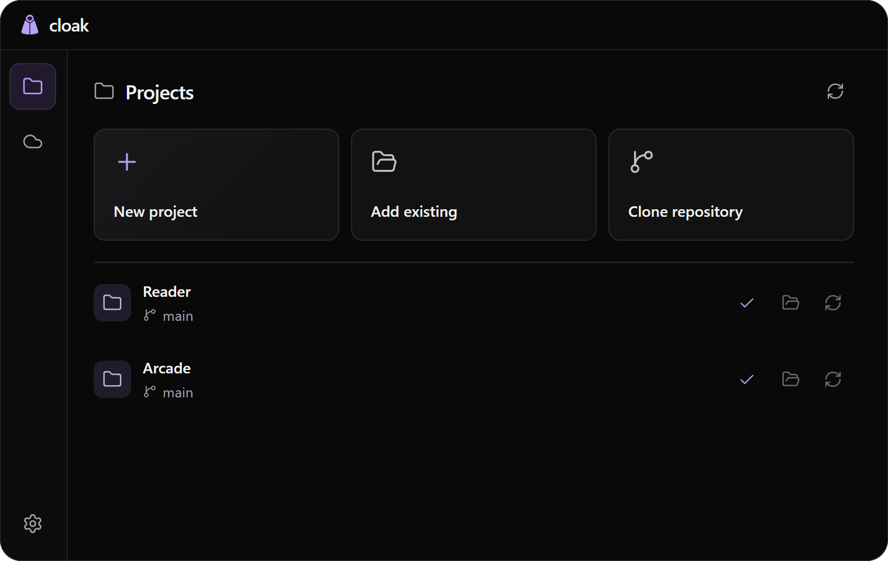

# Personal UI

Use Personal UI for app interfaces, settings, onboarding, installers, motion and product presentation. It records the owner's preferences while respecting the current product's design system.

```text
Use $personal-ui to improve these settings. Preserve the behavior and check the running app.
```

For installation and updates, use the [shared guide](installing.md). The skill's entry point is [personal-ui/SKILL.md](../personal-ui/SKILL.md).

## Find the relevant guidance

| Reference | Covers |
| --- | --- |
| [Preferences](../personal-ui/references/preferences.md) | Current feedback on controls, hierarchy, copy and interaction. |
| [Desktop patterns](../personal-ui/references/desktop-patterns.md) | Compact windows, settings, installers and native edges. |
| [Motion](../personal-ui/references/motion.md) | Transitions, progress and interrupted movement. |
| [README presentation](../personal-ui/references/readmes.md) | Product entry points, installation and screenshots. |
| [Repertoire](../personal-ui/references/repertoire.md) | Visual references chosen for the actual product type. |

Keep `frontend-design` installed if you use it. Personal UI resolves aesthetic conflicts for this owner; compatible implementation advice still applies. The current user request and established product design take precedence.

## Product example

[Cloak](https://github.com/zF4ke/cloak) is an approved example of a compact utility. Its layout is an example, not a template every product should inherit.

<p align="center"></p>

The Cloak example uses isolated test projects. Reference screenshots and collected artwork are for study, not redistribution as app artwork. [Validation notes](../personal-ui/references/validation.md) describe the checks and their limits.
